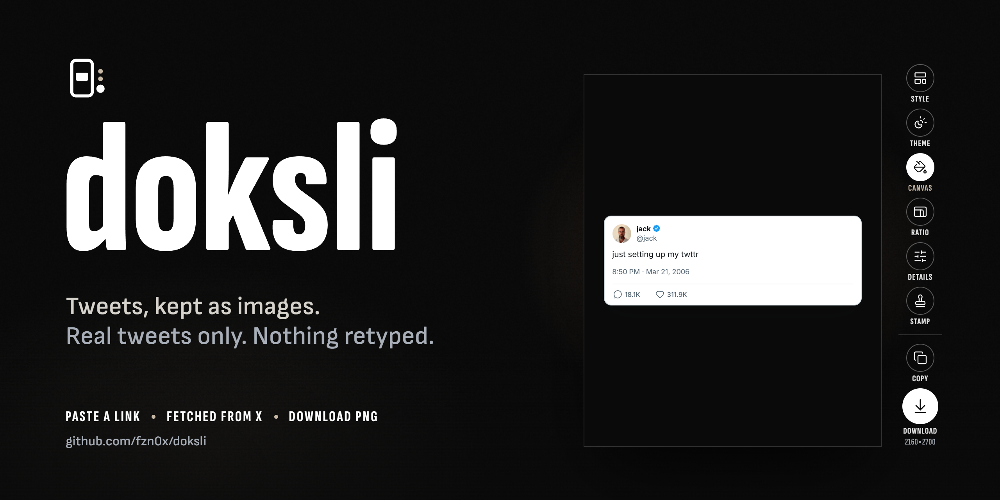
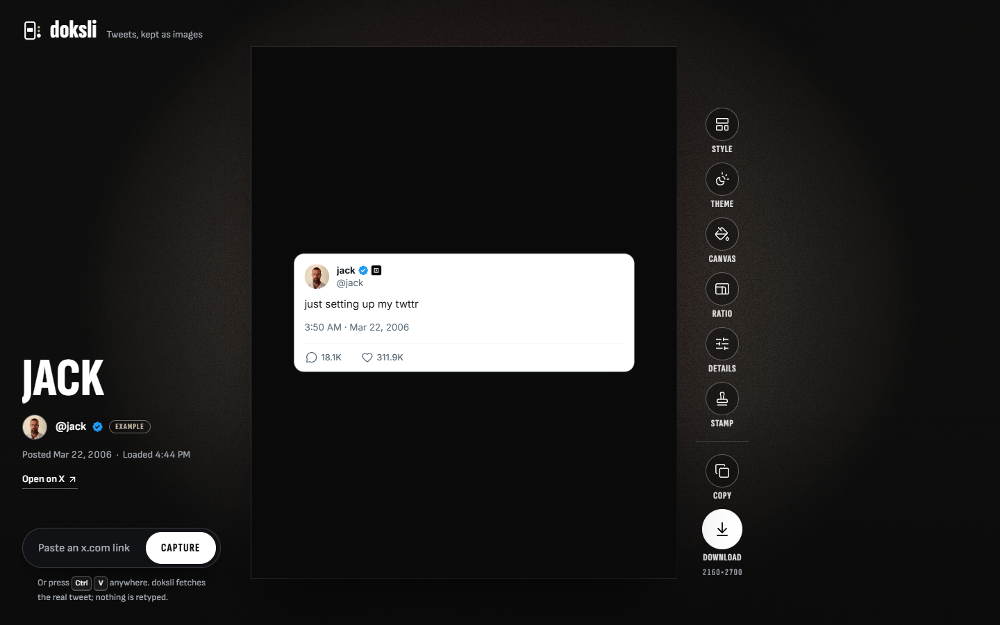
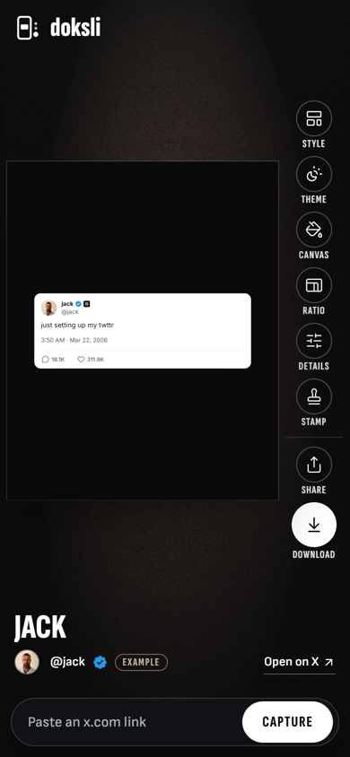
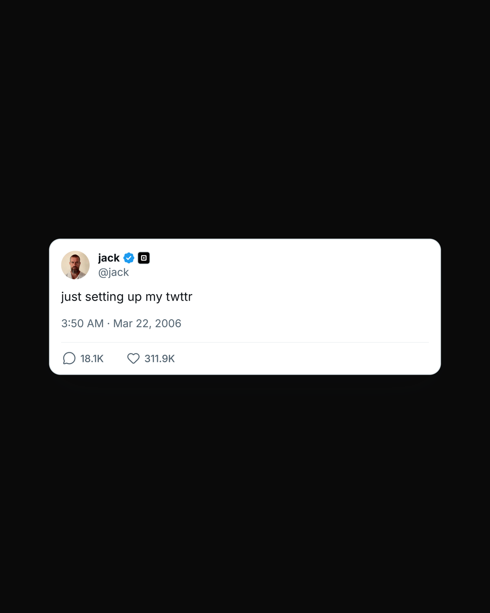
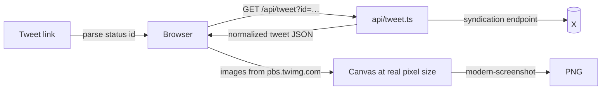

<div align="center">

<h1>
  <picture>
    <source media="(prefers-color-scheme: dark)" srcset="docs/brand/logo-light.svg">
    
  </picture>
</h1>

**Paste a tweet link. Keep it as an image.**

doksli fetches the real tweet from X and lays it out as a clean, high-resolution PNG for posts, stories, slides or proof.
Nothing is retyped, so nothing can be faked.

[](https://github.com/fzn0x/doksli/actions/workflows/ci.yml)
[](LICENSE)
[](https://vercel.com/new/clone?repository-url=https%3A%2F%2Fgithub.com%2Ffzn0x%2Fdoksli)



</div>

## Why doksli

Most tweet-image generators let you type any name and any text, which makes them fake-tweet generators. doksli only accepts a link. It fetches the tweet from X and renders exactly what was posted. You can change how the image looks, but not what it says.

## Features

| | |
| --- | --- |
| **Styles** | **X** recreates the x.com layout. **Quote** sets the words large for slides and posts. **Bare** drops the card and puts the text straight on the canvas. |
| **Themes** | Light, Dim and Dark, the same three themes X offers. |
| **Canvas** | Void, white, sand and other solids, two gradients, transparent, any custom colour, or **Spill**: a soft colour field taken from the tweet's own image. |
| **Ratios** | Auto (hugs the tweet), 1:1, 4:5, 9:16 (with Instagram/TikTok story overlays) and 16:9. Export at 1×, 2× or 3×. |
| **Details** | Show or hide metrics, timestamp, media and the verified badge. |
| **Receipt stamp** | Adds the tweet's link and the time you captured it under the tweet. Useful as proof if the tweet is later edited or deleted. |
| **Feed** | Every capture stays in a vertical snap feed in your browser, so you can come back and re-export. |
| **Export** | Download a PNG, copy it to the clipboard on desktop, or share it from your phone. |

Media, link previews, quote tweets, replies, and verified, business and government badges are all supported.

<p align="center">
  
</p>

<p align="center">
  
  &nbsp;&nbsp;
  
</p>

## Keyboard shortcuts

| Key | Action |
| --- | --- |
| <kbd>Ctrl</kbd>/<kbd>⌘</kbd> + <kbd>V</kbd> (anywhere) | Capture the tweet link on your clipboard |
| <kbd>/</kbd> | Focus the link field |
| <kbd>↑</kbd> <kbd>↓</kbd> or <kbd>K</kbd> <kbd>J</kbd> | Move through the feed |
| <kbd>Esc</kbd> | Close the open panel |

## Getting started

Requirements: **Node.js 20.19+** (22 LTS recommended) and **pnpm 10** (`corepack enable` sets it up).

```sh
git clone https://github.com/fzn0x/doksli.git
cd doksli
pnpm install
pnpm dev
```

Open http://localhost:5173 and paste a link such as `https://x.com/jack/status/20`.

The dev server also serves `/api/tweet`, so no extra backend process is needed locally.

### Scripts

| Command | What it does |
| --- | --- |
| `pnpm dev` | Start Vite with hot reload and the local tweet API |
| `pnpm build` | Type-check, then build the site to `dist/` |
| `pnpm preview` | Serve the production build locally, API included |
| `pnpm lint` | Lint and check formatting with Biome |
| `pnpm format` | Apply Biome's fixes and formatting |
| `pnpm typecheck` | Run the TypeScript compiler without emitting |

## How it works



1. **Parse.** The link is reduced to a status ID. x.com, twitter.com, mobile links, share links with `?s=` and fixer domains (fxtwitter, vxtwitter, fixupx) all work.
2. **Fetch.** `api/tweet.ts` calls X's public syndication endpoint, the one embedded tweets use, and returns a lean, normalized tweet. That endpoint only allows requests from platform.twitter.com, so the browser cannot call it directly and the proxy is required.
3. **Lay out.** The canvas is rendered at its real output size (for example 1080×1350 for 4:5) and scaled down on screen, so the preview and the PNG are the same layout.
4. **Export.** [modern-screenshot](https://github.com/qq15725/modern-screenshot) rasterizes the canvas with fonts and images embedded. Avatars and media come from `pbs.twimg.com`, which allows cross-origin use.

## Project structure

```
api/
  tweet.ts            Vercel function: fetch and normalize a tweet
src/
  App.tsx             Feed, capture flow, export actions
  components/
    cards/            X, Quote and Bare card styles
    TweetCanvas.tsx   The exported artifact, laid out at real pixel size
    Rail.tsx          Labeled action rail
    Panel.tsx         Style, theme, canvas, ratio, details and stamp panels
    CaptureBar.tsx    Link field and Capture button
  lib/                Parsing, formatting, settings, storage, export
  styles/             App shell and card styles
vite.config.ts        Serves api/tweet.ts during dev and preview
```

## Deploying

### Vercel (recommended)

Click **Deploy with Vercel** above, or import the repository at [vercel.com/new](https://vercel.com/new) and keep the defaults. Vercel detects Vite, serves `dist/`, and runs `api/tweet.ts` as a function at `/api/tweet`. No environment variables are needed.

### Other hosts

The site is static, but the app needs `/api/tweet`. `api/tweet.ts` exports a standard `GET(request: Request): Promise<Response>` handler, so it ports to Netlify Functions, Cloudflare Pages Functions or any runtime with the Fetch API.

## Limitations

- **Unavailable tweets.** Deleted, protected and age-restricted tweets cannot be fetched. doksli says so instead of failing silently.
- **Missing metrics.** The syndication endpoint reports replies and likes, but not reposts or views. doksli shows only what it receives and never fills in numbers.
- **Unofficial endpoint.** It is undocumented and X can change it at any time.
- **Stand-in typeface.** The X style uses Inter as a stand-in for X's proprietary Chirp typeface.

## Privacy

Your captures and settings are stored in your browser's `localStorage` and never leave your device. The API proxy does not store tweets; responses are cached at the edge for five minutes.

## Brand

Brand assets live in [`docs/brand`](docs/brand):

| File | Use |
| --- | --- |
| `logo-light.svg` | Logo for dark backgrounds (white mark and wordmark) |
| `logo-dark.svg` | Logo for light backgrounds |
| `mark.svg` | App icon on its void tile; also the favicon |
| `cover.png` | README banner (2560×1280) |
| `social-preview.png` | GitHub social preview (1280×640) |

The mark is the app itself: a tall stage holding a captured card, with the rail beside it ending in the filled Download button. The wordmark is Sofia Sans Extra Condensed ExtraBold, converted to outlines, and always set in lowercase.

| Token | Hex | Role |
| --- | --- | --- |
| Void | `#0a0a0a` | Ground |
| White | `#ffffff` | Glyphs, primary action |
| Sand | `#c7b9a6` | The one warm accent: engaged state, focus |
| Haze | `#a9afb8` | Secondary text |

## Contributing

Issues and pull requests are welcome. Please read [CONTRIBUTING.md](CONTRIBUTING.md) first.

## License

[MIT](LICENSE) © fzn0x

doksli is not affiliated with or endorsed by X Corp. Tweets belong to their authors. Respect their rights when you share captures.
